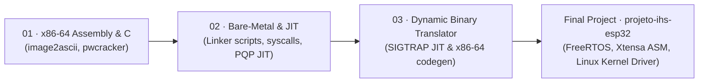

# Hardware-Software Interface (IHS)

Low-level systems programming, bare-metal linking, and dynamic JIT binary translation projects developed during the **Hardware-Software Interface (IHS)** course at the Federal University of Sergipe (**UFS**).

> Looking for the **ESP32 + FreeRTOS + Linux Kernel Module Rover** final project? See [`projeto-ihs-esp32`](https://github.com/RafaelGomes8994/projeto-ihs-esp32).

---

## 🧭 Progression Overview

---

## 📁 Repository Structure

| Directory | Focus | Key Files |
| :--- | :--- | :--- |
| [`01_assembly_and_c/image2ascii_x86_64/`](01_assembly_and_c/image2ascii_x86_64/) | Pure **x86-64 Assembly** image-to-ASCII renderer | [`rafaelgomes_202300095730_image2ascii.s`](01_assembly_and_c/image2ascii_x86_64/rafaelgomes_202300095730_image2ascii.s) |
| [`01_assembly_and_c/pwcracker/`](01_assembly_and_c/pwcracker/) | Low-level C optimization & brute-force cracker | [`rafaelgomes_202300095730_pwcracker.c`](01_assembly_and_c/pwcracker/rafaelgomes_202300095730_pwcracker.c) |
| [`02_jit_and_bare_metal/baremetal_boot_vp1/`](02_jit_and_bare_metal/baremetal_boot_vp1/) | Custom linker script & startup assembly (bare-metal boot) | [`start.s`](02_jit_and_bare_metal/baremetal_boot_vp1/start.s), [`vp1.ld`](02_jit_and_bare_metal/baremetal_boot_vp1/vp1.ld), [`vp1.c`](02_jit_and_bare_metal/baremetal_boot_vp1/vp1.c) |
| [`02_jit_and_bare_metal/baremetal_syscalls_vp2/`](02_jit_and_bare_metal/baremetal_syscalls_vp2/) | Bare-metal startup, specs & custom syscall stubs | [`syscall.c`](02_jit_and_bare_metal/baremetal_syscalls_vp2/syscall.c), [`vp2.ld`](02_jit_and_bare_metal/baremetal_syscalls_vp2/vp2.ld), [`start.s`](02_jit_and_bare_metal/baremetal_syscalls_vp2/start.s) |
| [`02_jit_and_bare_metal/jit_modexp/`](02_jit_and_bare_metal/jit_modexp/) | Runtime x86-64 machine-code generation (`modexp`) | [`modexp.c`](02_jit_and_bare_metal/jit_modexp/modexp.c), [`Makefile`](02_jit_and_bare_metal/jit_modexp/Makefile) |
| [`02_jit_and_bare_metal/pqp_jit_translator/`](02_jit_and_bare_metal/pqp_jit_translator/) | PQP virtual ISA interpreter & JIT translator | [`README.md`](02_jit_and_bare_metal/pqp_jit_translator/README.md), [`rafaelgomes_202300095730_pqp.c`](02_jit_and_bare_metal/pqp_jit_translator/rafaelgomes_202300095730_pqp.c) |
| [`03_dynamic_binary_translator/`](03_dynamic_binary_translator/) | Lazy **SIGTRAP/SIGSEGV** dynamic JIT binary translator | [`jit_binary_translator.c`](03_dynamic_binary_translator/jit_binary_translator.c) |

---

## 🛠️ Highlight: Dynamic JIT Binary Translator

- **File:** [`03_dynamic_binary_translator/jit_binary_translator.c`](03_dynamic_binary_translator/jit_binary_translator.c)
- **Executable Memory:** Allocates `PROT_READ | PROT_WRITE | PROT_EXEC` buffers via `mmap` pre-filled with `0xCC` (`INT3` breakpoints).
- **Lazy Compilation:** Traps `SIGTRAP` via `sigaction(SA_SIGINFO | SA_ONSTACK)`, inspects guest state via `ucontext_t`, emits native x86-64 opcodes (`MOV`, `ADD`, `SUB`, `AND`, `OR`, `XOR`, `SAL`, `SAR`, `CMP`, `JMP`, `JG`, `JL`, `JE`) plus SSE/XMM instruction counters, and resumes execution in place.
- **Exit Trapping:** Captures `SIGSEGV` on termination to dump final GPR/XMM register states and execution traces.
